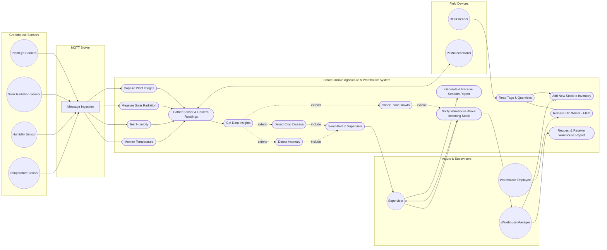
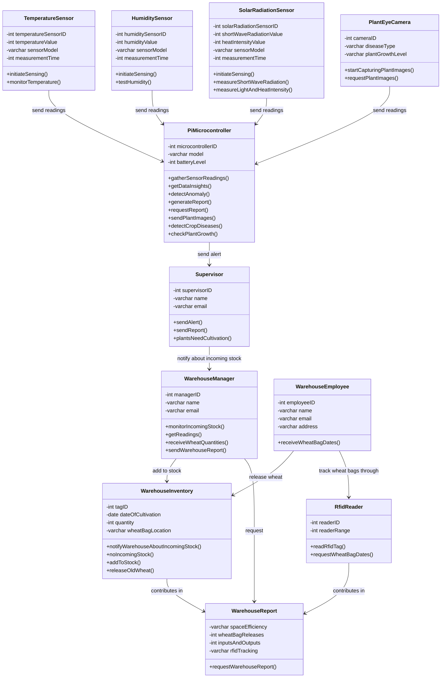
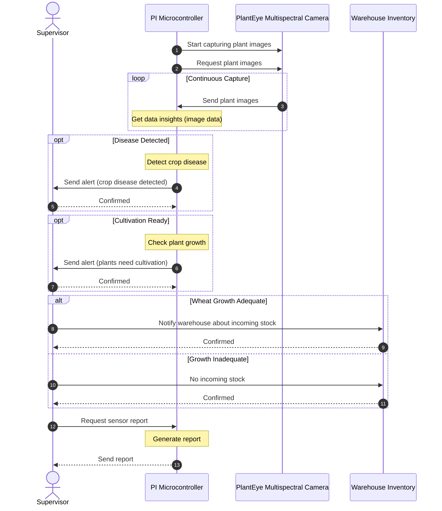
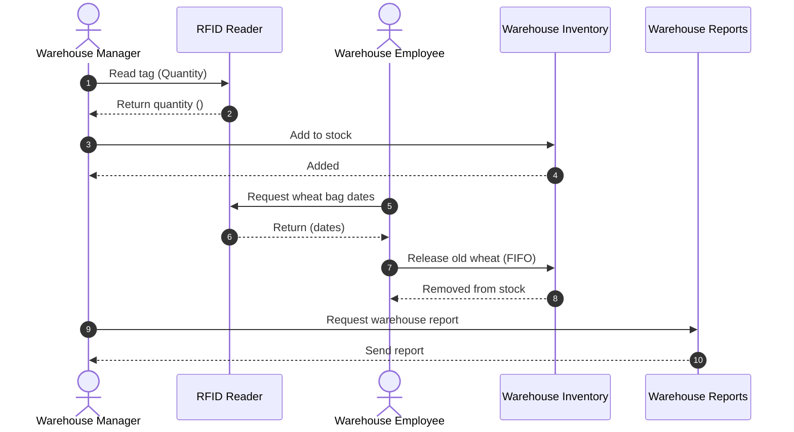
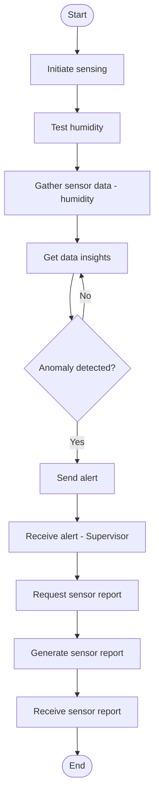
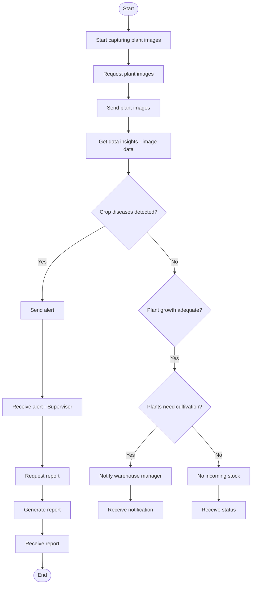

# 🌾 Smart Climate Agriculture & Warehouse Management System (UML & System Architecture)

A complete system analysis and object-oriented architectural design for an IoT and cloud-integrated agriculture and inventory tracking platform.

---

## 📌 Project Overview
A smart agriculture enterprise operates connected greenhouses and automated wheat storage warehouses. The platform integrates **IoT sensors, PlantEye multispectral cameras, RFID tags, Raspberry Pi microcontrollers, and AWS cloud analytics** to eliminate manual delays, automate disease detection, and enforce FIFO inventory dispatch.

---

## ⚙️ Core System Architecture
* **Greenhouse Layer:** Real-time monitoring of temperature, humidity, and solar radiation with automated anomaly detection.
* **Crop Analytics:** Automated plant disease detection and growth assessment using multispectral image processing.
* **Warehouse Management:** Automated grain bag tracking via RFID scanners and strict FIFO stock rotation.
* **Communication & Cloud:** MQTT brokers connecting microcontrollers with AWS cloud storage and operational dashboards.

---
---

## 📋 System Requirements

### Environmental Monitoring Requirements
* **FR1:** The system allows the temperature sensor to continuously monitor greenhouse temperature.
* **FR2:** The system allows the humidity sensor to continuously monitor greenhouse humidity.
* **FR3:** The system allows the solar radiation sensor to measure shortwave radiation levels.
* **FR4:** The system allows the solar radiation sensor to measure light and heat intensity.
* **FR5:** The system allows the PlantEye camera to capture images of wheat crops for health analysis.

### Data Processing & Alerting Requirements
* **FR6:** The system allows the PI microcontroller to gather readings from all sensors and cameras.
* **FR7:** The system analyzes collected environmental and crop data in real time.
* **FR8:** The system detects environmental anomalies based on predefined thresholds.
* **FR9:** The system detects crop diseases and pest indications using image analysis.
* **FR10:** The system evaluates plant growth status and determines cultivation needs.
* **FR11:** The system sends automated alerts to the supervisor when abnormal conditions are detected.

### RFID & Warehouse Management Requirements
* **FR12:** The system allows the supervisor to notify warehouse inventory about incoming wheat stock.
* **FR13:** The system allows RFID readers to scan wheat bag tags during storage.
* **FR14:** The system allows the warehouse manager to add incoming stock and track storage dates.
* **FR15:** The system identifies older wheat batches and guides release according to the FIFO method.
* **FR16:** The system generates automated warehouse and inventory reports.
## 📊 System Diagrams & Documentation

### 1. Use Case Diagram
Models external actors (sensors, supervisors, warehouse operators) and interactions with the MQTT broker and core system logic.



### 2. Class Diagram
Defines the object structure, attributes, data types, and inter-class relationships.




### 3. Sequence Diagrams
Illustrates the temporal exchange of messages between microcontrollers, sensors, cloud services, and actors:
* **Greenhouse Monitoring & Anomaly Alerting:**
 ```mermaid
sequenceDiagram
    autonumber
    actor Supervisor
    participant Microcontroller as PI Microcontroller
    participant Sensor as Solar Radiation Sensor

    Microcontroller->>Sensor: Initiate sensing
    Sensor-->>Microcontroller: Measure short-wave radiation

    loop Continuous Sensing
        Sensor->>Microcontroller: Gather sensor data (wavelength data)
        Note over Microcontroller: Get data insights
    end

    opt Wavelength exceeds range
        Note over Microcontroller: Detect anomaly
        Microcontroller->>Supervisor: Send alert (wavelength exceeds)
        Supervisor-->>Microcontroller: Confirmed
    end

    Supervisor->>Microcontroller: Request report
    Note over Microcontroller: Generate report
    Microcontroller-->>Supervisor: Send report
```
* **Plant Health Analysis & Cultivation Notification:**

  
* **RFID Warehouse Ingestion & FIFO Stock Release:**

  
### 4. Activity Diagrams
Step-by-step business workflows covering anomaly branches, alerting thresholds, and inventory updates.
* **Crop Image Capture & Analysis Flow:**



* **FIFO Warehouse Release Workflow:**
 ```mermaid
flowchart TD
    Start([Start]) --> C1[Read RFID Tag]
    C1 --> C2[Return quantity]
    C2 --> C3[Add new stock to inventory]
    
    C3 --> C4[Request wheat dates]
    C4 --> C5[Return dates]
    C5 --> C6[Release old wheat by date - FIFO]
    C6 --> C7[Remove stock from inventory]
    
    C7 --> C8[Request warehouse report]
    C8 --> C9[Send report]
    C9 --> EndNode([End])
```
---

## 🛠️ Tools & Standards
* **Modeling Tool:** Visual Paradigm
* **Standard:** UML 2.0 (Use Case, Class, Sequence, Activity)
* **Target Architecture:** IoT Sensors, MQTT Broker, AWS Cloud Platform, RFID Tracking
